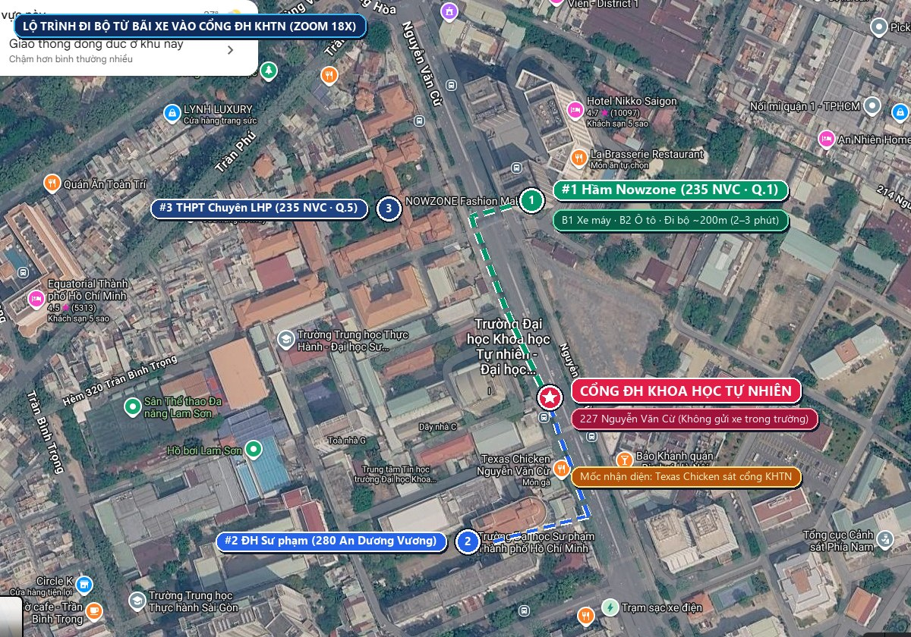
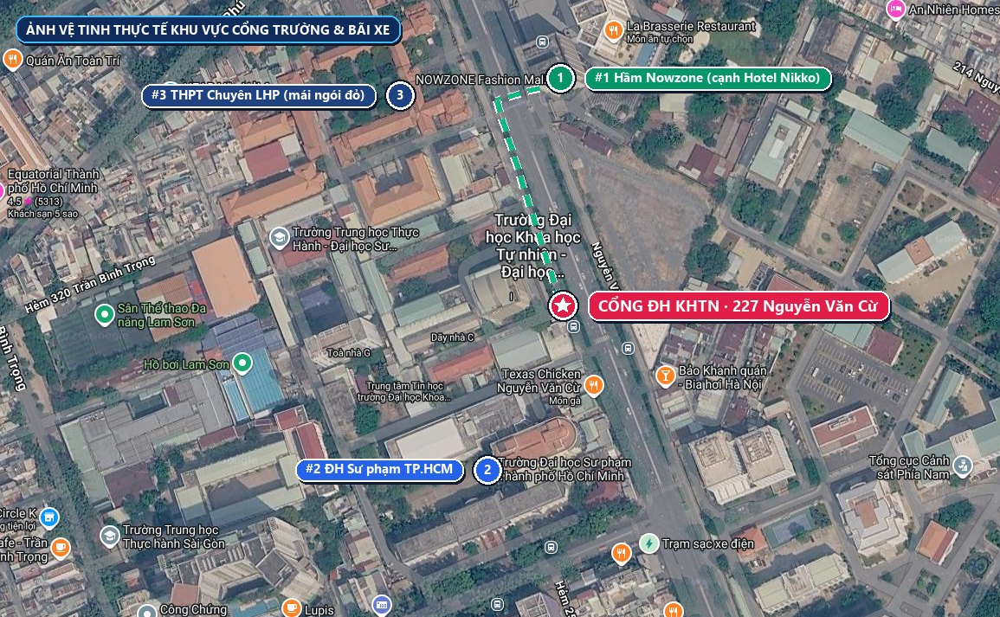
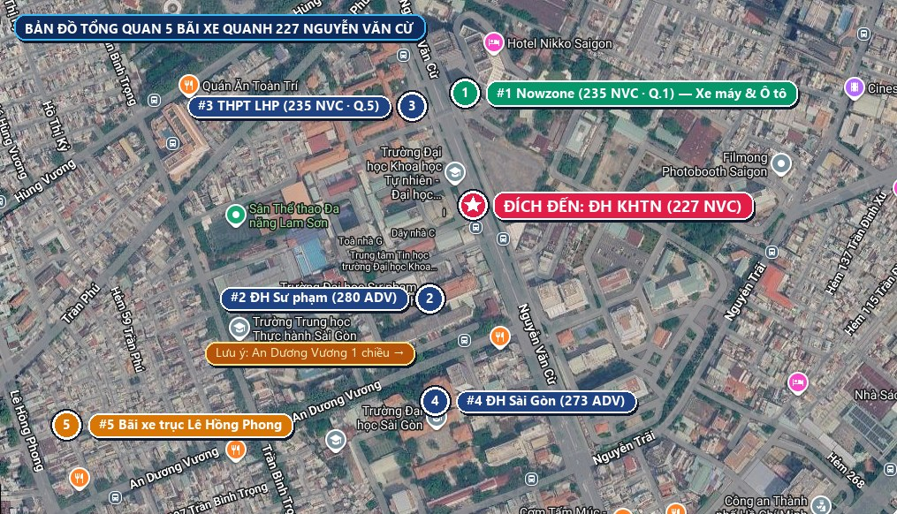

# Hướng dẫn đường đi & gửi xe tốt nghiệp — ĐH Khoa học Tự nhiên (227 Nguyễn Văn Cừ, Q.5)

Trang web tĩnh (mobile-first) hướng dẫn chi tiết cách di chuyển, tránh đường 1 chiều và chọn bãi gửi xe máy / ô tô cho người thân, bạn bè lần đầu đến dự Lễ tốt nghiệp tại **Trường ĐH Khoa học Tự nhiên ĐHQG-HCM — Cơ sở 1 (227 Nguyễn Văn Cừ, P. Chợ Quán / Q.5 cũ, TP.HCM)**.

## Ảnh chụp Google Maps đánh dấu trực quan

### Lộ trình đi bộ từ bãi xe vào cổng ĐH KHTN (Zoom 18x)

### Ảnh vệ tinh thực tế khu vực cổng trường & bãi xe

### Bản đồ tổng quan 5 bãi gửi xe & chiều đường 1 chiều

## Tóm tắt nhanh 5 điểm gửi xe bên ngoài (không gửi trong trường KHTN)

| # | Địa điểm | Khoảng cách | Loại xe | Ghi chú |
|---|---|---|---|---|
| 1 | **TTTM Nowzone** (`235 Nguyễn Văn Cừ, Q.1`) | ~200m (2–3 phút) | Xe máy (B1) & Ô tô (B2) | **Khuyên dùng #1**, hầm rộng, mát, mở đến 22:00 |
| 2 | **ĐH Sư phạm TP.HCM** (`280 An Dương Vương, Q.5`) | ~120m (1–2 phút) | Xe máy | Gần nhất, giá sinh viên (đi đúng chiều 1 chiều ADV) |
| 3 | **THPT Chuyên Lê Hồng Phong** (`235 Nguyễn Văn Cừ, Q.5`) | ~140m (2 phút) | Xe máy | Cùng vỉa hè, chỉ gửi được tùy quy định mở cổng |
| 4 | **ĐH Sài Gòn** (`273 An Dương Vương, Q.5`) | ~330m (4–5 phút) | Xe máy | Dự phòng rộng rãi (đi đúng chiều 1 chiều ADV) |
| 5 | **Bãi xe tư nhân trục Lê Hồng Phong** | ~300m (4–5 phút) | Xe máy & Ô tô | Dự phòng ngày đêm, nhớ hỏi kỹ giá trước |

## Ảnh infographic khổ lớn (gửi Zalo / Messenger)
- `huong-dan-gui-xe-doc.png` (`1620 × 2880 px` — khổ dọc cho điện thoại)
- `huong-dan-gui-xe-ngang.png` (`2400 × 1440 px` — khổ ngang cho máy tính / in ấn)

## Lưu ý quan trọng cho người mới tới
1. **Không chọn nhầm cơ sở:** Gõ đúng `227 Nguyễn Văn Cừ, Quận 5` (Cơ sở 1), tránh nhầm Cơ sở 2 Linh Trung (TP. Thủ Đức).
2. **Tránh nhầm hai số `235 Nguyễn Văn Cừ`:** Nowzone nằm phía **Quận 1** (cạnh Hotel Nikko Saigon), còn THPT Chuyên Lê Hồng Phong nằm phía **Quận 5** (cùng dãy sát KHTN).
3. **Đường 1 chiều:** Đoạn **An Dương Vương** trước cổng ĐH Sư phạm / ĐH Sài Gòn chạy 1 chiều hướng từ Lê Hồng Phong ra Nguyễn Văn Cừ; **Trần Phú** 1 chiều từ Ngã sáu xuống; **Hùng Vương** 1 chiều lên Ngã sáu.

## Cấu trúc dự án
- `index.html` — Giao diện chính (chọn nhanh phương tiện, ảnh Google Maps có Lightbox, hướng dẫn từng bước, bản đồ tương tác Leaflet, bộ lọc 6 điểm gửi xe)
- `data.js` — Dữ liệu địa điểm, tọa độ, ảnh bản đồ và hướng dẫn từng bước
- `app.js` — Logic tab ảnh/lộ trình, bộ lọc, bản đồ Leaflet, Lightbox và sao chép địa chỉ
- `styles.css` — Giao diện responsive tối ưu cho điện thoại
- `assets/` — 3 ảnh chụp Google Maps đã cắt gọn và đánh dấu lộ trình đi bộ
